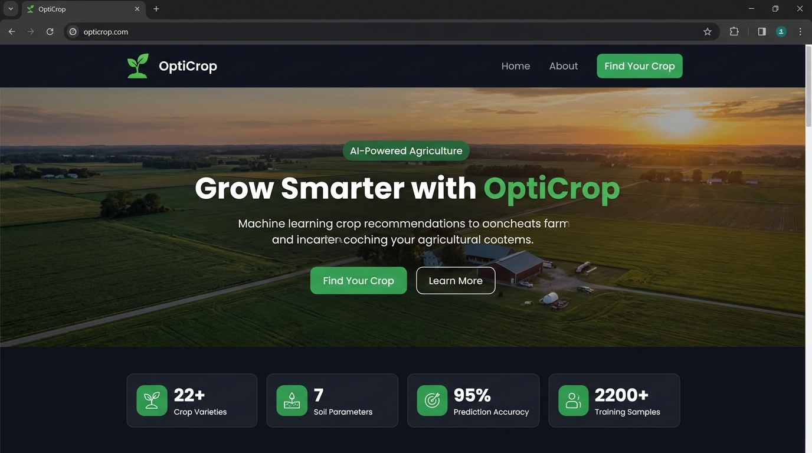
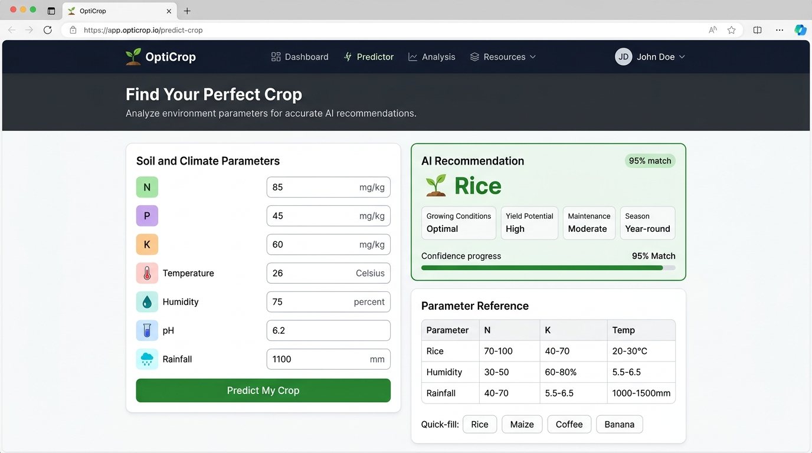

# OptiCrop – Smart Agricultural Production Optimization Engine

A machine learning-based crop recommendation system where farmers can enter their soil and climate conditions and get an instant prediction of the best crop to grow. The project has a live frontend demo deployed on GitHub Pages.

**Live Demo:** https://ramya-nadipalli.github.io/OptiCrop-Smart-Agricultural-Production-Optimization-Engine/

---

## Screenshots

**Home Page**


**Crop Prediction Form**


---

## About the Project

I built this as a data science and full-stack project to solve a real problem in agriculture — farmers usually make decisions about what to grow based on tradition or guesswork, without knowing if the soil and climate actually suit that crop. Poor crop selection leads to low yields, wasted fertilizers, and financial loss.

OptiCrop fixes this by letting you enter 7 soil and environmental parameters and instantly getting back an AI recommendation. The backend uses a Logistic Regression model trained on 2,200+ agricultural records, achieving over 95% accuracy across 22 different crop types.

I also built a standalone static frontend version (HTML/CSS/JS) that runs without any server, so anyone can see the working interface live on GitHub Pages.

---

## Features

- Enter 7 soil and climate parameters: N, P, K, Temperature, Humidity, pH, Rainfall
- Instant crop prediction powered by a trained ML model (Logistic Regression)
- Result card showing crop name, confidence score, growing conditions, and yield potential
- Quick-fill sample buttons for Rice, Maize, Coffee, Banana
- Parameter reference guide with typical ranges for each input
- Fully responsive design — works on mobile and desktop
- Static frontend demo hosted on GitHub Pages (no server needed to view)

---

## Tech Stack

**Backend (Flask/ML version):**
- Python 3
- Flask
- Scikit-learn (Logistic Regression)
- Pandas, NumPy
- Pickle (model serialization)

**Frontend (Live Demo version):**
- HTML5, CSS3, JavaScript
- Rule-based prediction engine for demo mode
- Deployed on GitHub Pages

---

## How to Run Locally (Flask Version)

```bash
# 1. Clone the repo
git clone https://github.com/ramya-nadipalli/OptiCrop-Smart-Agricultural-Production-Optimization-Engine.git
cd OptiCrop-Smart-Agricultural-Production-Optimization-Engine

# 2. Install dependencies
pip install -r requirements.txt

# 3. Run the app
python app.py

# 4. Open in browser
# Go to http://127.0.0.1:5000
```

---

## Project Structure

```
OptiCrop/
├── app.py                  # Flask backend
├── model/
│   └── model.pkl           # Trained ML model
├── Templates/
│   ├── home.html           # Home page
│   ├── FindYourCrop.html   # Prediction form page
│   └── about.html          # About page
├── static/
│   ├── home.css
│   ├── FindYourCrop.css
│   ├── about.css
│   └── images/
├── index.html              # Static demo for GitHub Pages
├── requirements.txt
├── Procfile
└── README.md
```

---

## Dataset

The model was trained on the [Crop Recommendation Dataset](https://www.kaggle.com/datasets/atharvaingle/crop-recommendation-dataset) which contains 2,200 records with 7 features and 22 crop labels.

| Parameter   | Description                        |
|-------------|-----------------------------------|
| N           | Nitrogen content in soil (mg/kg)  |
| P           | Phosphorus content (mg/kg)        |
| K           | Potassium content (mg/kg)         |
| Temperature | Average temperature (°C)          |
| Humidity    | Relative humidity (%)             |
| pH          | Soil pH level (0–14)              |
| Rainfall    | Annual rainfall (mm)              |

---

## Author

Built by **Ramya Nadipalli** — B.Tech Student

- GitHub: [@ramya-nadipalli](https://github.com/ramya-nadipalli)
